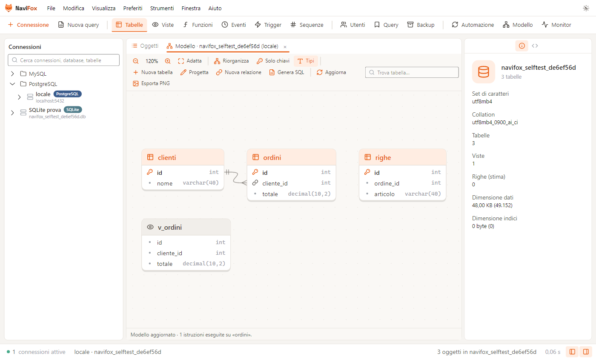
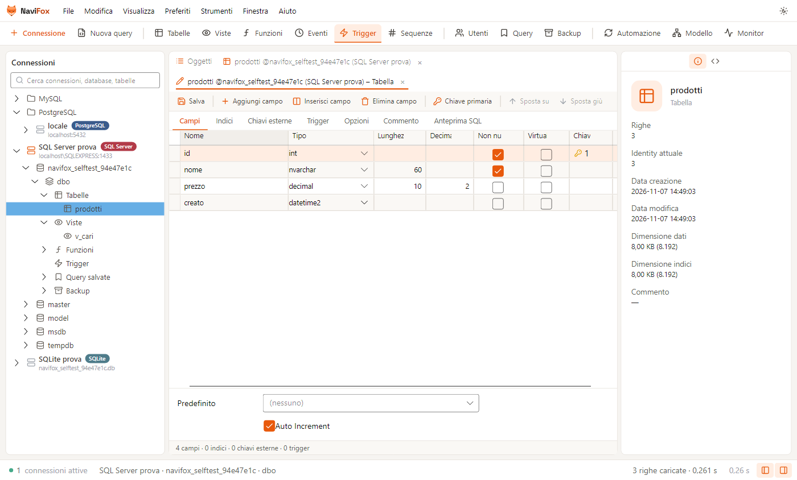
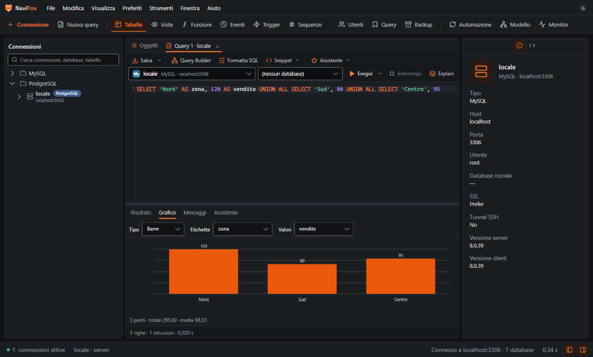

<p align="center">
  
</p>

<p align="center">
  <b>Il client desktop per database relazionali, in italiano.</b><br>
  MySQL · MariaDB · PostgreSQL · SQL Server · SQLite — da un'unica finestra.
</p>

<p align="center">
  <a href="https://code965.github.io/Navifox/"><b>Sito web</b></a> ·
  <a href="https://github.com/Code965/Navifox/releases/latest/download/Navifox-win-Setup.exe"><b>Scarica per Windows</b></a>
</p>

<p align="center">
  <a href="LICENSE"></a>
  
  
</p>

---

Navifox è un'applicazione desktop per **esplorare, progettare, interrogare e amministrare** database relazionali.
Unisce in un'interfaccia moderna (tema chiaro e scuro, palette arancione) gli strumenti di tutti i giorni:
albero delle connessioni, griglia dati modificabile, editor SQL con autocompletamento, progettazione delle tabelle,
modello ER, trasferimento e sincronizzazione dei dati, backup, monitor del server e un assistente SQL basato sull'intelligenza artificiale (Claude, OpenAI, Gemini o modelli locali).

È scritto in C# con [.NET 10](https://dotnet.microsoft.com/) e [Avalonia](https://avaloniaui.net/), interamente in italiano.



## Database supportati

| Database | Varianti e servizi compatibili | Note |
|---|---|---|
| **MySQL / MariaDB** | TiDB, Amazon Aurora MySQL | eventi pianificati, utenti e privilegi |
| **PostgreSQL** | Supabase, Neon, Amazon Aurora PostgreSQL, CockroachDB, TimescaleDB | schemi, sequenze, funzioni e procedure, utenti e ruoli |
| **SQL Server** | Azure SQL Database | autenticazione SQL o di Windows, istanze con nome (`server\ISTANZA`), script con `GO` |
| **SQLite** | file `.db`, `.sqlite`, `.sqlite3` | modifica della struttura con ricostruzione sicura della tabella |

Le connessioni possono passare da un **tunnel SSH** (password o chiave privata, con verifica dell'impronta del server) e usare **SSL/TLS**.

## Funzionalità

### Connessioni
- Cartelle e sottocartelle, ordine libero con trascinamento, rinomina con F2.
- **Colore** e **ambiente** (Sviluppo, Test, Produzione) per ogni connessione: sulle connessioni di produzione
  Navifox chiede conferma prima di ogni modifica.
- Password cifrate con la protezione dati di Windows (DPAPI); importazione ed esportazione delle connessioni.
- Pagina iniziale con connessioni e tabelle recenti, **barra comandi Ctrl+K** per trovare qualsiasi comando, database o tabella.

### Dati
- Griglia modificabile con paginazione, filtri, ordinamento dal menu dell'intestazione e **transazioni** esplicite.
- Selezione di righe e colonne (anche con Maiusc + frecce), copia come TSV, **INSERT** o **UPDATE**.
- **Vista modulo**, editor di campo testo / esadecimale / JSON / immagine.
- **Freccia giù sull'ultima riga dell'ultima pagina** crea una nuova riga e porta il cursore al primo campo modificabile;
  una bozza ancora vuota viene riutilizzata.
- **Copia righe / Ctrl+Maiusc+C** (oppure Ctrl+C con righe intere selezionate) e **Incolla righe / Ctrl+V** tra tabelle:
  abbinamento per nome anche con colonne riordinate, conservazione di NULL, testo vuoto e binari, rigenerazione degli ID automatici
  ed esclusione dei campi calcolati. Colonne non corrispondenti, campi obbligatori e chiavi già presenti nella pagina vengono segnalati.
  Le righe sono aggiunte alla griglia e si salvano con **✓ / Ctrl+S**; è supportato anche il testo separato da tabulazioni da Excel.
- Chiavi esterne: scelta del valore dalla tabella collegata e apertura dei record riferiti.
- Editor del valore del campo **a destra o in basso**, a scelta.
- Ricerca nei dati della tabella e **ricerca in tutto il database**.
- Import (CSV, testo delimitato, Excel, JSON) ed export (CSV, testo, HTML, Excel, SQL, XML, JSON, Markdown), stampa.
- Nell'elenco Oggetti puoi selezionare più tabelle con Ctrl/Maiusc o Ctrl+A ed eliminarle con **Elimina selezionate**, Canc o il menu contestuale.
  Una sola conferma elenca tutti gli oggetti; le dipendenze da tabelle non selezionate vengono segnalate prima dell'eliminazione.

**Import Wizard** importa in una tabella esistente oppure crea una nuova tabella da CSV, testo delimitato, Excel `.xlsx` o JSON.
Puoi avviarlo anche senza una tabella selezionata, oppure trascinare un file sulla tabella nell'albero, nell'elenco Oggetti
o nella sua scheda dati. Trascinando sullo spazio libero dell'elenco o sulla categoria Tabelle si prepara una nuova tabella.
Il trascinamento apre il wizard con il file e la destinazione già impostati: l'importazione parte soltanto con **Avvia**.

I passaggi permettono di scegliere codifica, delimitatori, foglio Excel, riga delle intestazioni, prima e ultima riga dati,
formati di data/ora, separatore decimale e codifica binaria. Per le nuove tabelle puoi rivedere nomi e tipi delle colonne
suggeriti dalle prime 200 righe. Seguono mappatura, modalità di importazione, riepilogo e registro degli esiti.
Le celle numeriche e le date native di Excel conservano il proprio valore; gli ID automatici e le colonne calcolate sono esclusi dalla mappatura.

### Editor SQL
- Evidenziazione, **autocompletamento** di tabelle, colonne e parole chiave con le lettere digitate evidenziate, formattazione, snippet.
- Esecuzione di tutto, della selezione o dell'istruzione corrente; **EXPLAIN**; più risultati per script.
- **Query Builder** visuale, console, registro cronologia, **query salvate** nella libreria.
- **Grafici** dai risultati: barre, linee, area, torta.
- **Modalità sicura**: conferma per `UPDATE`/`DELETE` senza `WHERE`, `DROP` e `TRUNCATE`.

Con **Salva / Ctrl+S** scegli il nome della query e la ritrovi subito in **Query salvate** sotto il database corrente.
Navifox crea il relativo file `.sql` nella cartella dati, separato per connessione e database; i salvataggi successivi
aggiornano la stessa query. **Salva con nome** crea una copia, mentre **Esporta file SQL** permette di scegliere un percorso esterno.
Le query salvate dalle versioni precedenti vengono mantenute e convertite in file SQL automaticamente.

### Registro attività

**Strumenti › Registro attività / Ctrl+L** conserva le istruzioni eseguite da Navifox, comprese quelle generate dalla griglia,
dalle importazioni e da Data Transfer. Ogni attività ha un numero progressivo, sessione, gruppo di operazione, connessione,
database, SQL completo, parametri ed esito. Il registro è locale (`%APPDATA%\Navifox\activities.db`) e non viene svuotato automaticamente.
La cronologia precedente viene importata una sola volta, mantenendo il file originale.

Nei trasferimenti vengono archiviati origine, destinazione, opzioni, passaggi, tutti gli INSERT con i valori effettivi,
vincoli, COMMIT e ROLLBACK. Sono conservati anche i blocchi SQL esportati su file, distinguendoli dai comandi eseguiti sul server.
Puoi cercare per SQL, connessione, database, sessione o operazione, filtrare trasferimenti ed esiti da verificare,
consultare i dettagli, caricare le attività precedenti ed esportare il registro completo dei filtri in JSON.

**Esporta script operazione** prepara, nell'ordine originale, lo SQL del gruppo per la connessione e il database selezionati.
**Script completo del database** raccoglie invece tutte le operazioni archiviate per quella destinazione, anche di sessioni diverse;
le esportazioni su file restano commentate perché non hanno modificato il database sorgente.
I comandi falliti, incerti, parametrici e quelli dello storico precedente restano commentati, con le informazioni necessarie
per rivederli. Lo script va controllato prima di eseguirlo: per ricostruire un database serve anche una base iniziale compatibile
e vanno rispettate le transazioni. Il registro copre le operazioni fatte tramite Navifox e non sostituisce un backup del server.

Il comando viene registrato prima dell'esecuzione: se il registro non è scrivibile, l'operazione viene fermata e segnalata.
Le istruzioni senza esito dopo una chiusura anomala vengono indicate come **Da verificare**, senza presumere che non abbiano modificato dati.

### Assistente SQL con l'intelligenza artificiale
L'assistente conosce la struttura del database collegato e:
- **spiega** una query;
- **scrive l'SQL** a partire da una richiesta in italiano;
- **suggerisce indici** e riscritture partendo dal piano di esecuzione;
- **corregge** l'ultimo errore.

Funziona con il fornitore che preferisci (Strumenti › Opzioni › Assistente SQL): **Claude** (Anthropic), **OpenAI**,
**Google Gemini**, **Mistral**, **Groq**, **OpenRouter**, **DeepSeek**, **xAI**, qualsiasi servizio compatibile con l'API OpenAI
e i **modelli in locale** con [Ollama](https://ollama.com/) o [LM Studio](https://lmstudio.ai/), senza chiave e senza inviare nulla fuori dal computer.
Il pulsante «Carica modelli» legge l'elenco dei modelli direttamente dal fornitore.

Vengono inviate solo la query e la struttura (nomi di tabelle e colonne), mai i dati delle righe.
Le chiavi sono salvate cifrate sul computer, una per fornitore.

### Struttura del database
- **Progetta tabella**: campi, indici, chiavi esterne, trigger, opzioni, commenti, con anteprima delle istruzioni SQL.
- Editor di viste, funzioni, procedure, trigger, eventi (MySQL) e sequenze (PostgreSQL).
- **Modello ER**: diagramma automatico, nuove relazioni trascinando da una colonna a un'altra tabella,
  eliminazione delle relazioni, nuova tabella dal diagramma, **script SQL completo del modello**, esportazione PNG.



### Strumenti
- **Trasferimento dati** tra database e connessioni dello stesso tipo, con registro di tutte le istruzioni e avanzamento in percentuale.
- **Genera dati di prova** dal menu della tabella, dalla barra della griglia o da Strumenti: regole modificabili per colonna,
  anteprima delle prime 10 righe e dello SQL, seme riproducibile, nomi e codici italiani, valori delle chiavi esterne già presenti.
  Le colonne automatiche e calcolate sono escluse; gli inserimenti avvengono in transazione e gli errori annullano l'intero lotto.
- Nel **Trasferimento dati**, l'opzione **Maschera i dati personali riconosciuti** sostituisce i campi individuati per nome e tipo
  nella copia o nel file SQL, lasciando invariata l'origine. Prima dell'avvio mostra i campi interessati; chiavi primarie,
  colonne delle relazioni e campi non riconosciuti restano invariati. Non garantisce l'anonimizzazione completa:
  controlla il risultato prima di distribuirlo. I sostituti sono coerenti nella stessa copia e cambiano tra trasferimenti.
- **Sincronizzazione** di struttura e dati con anteprima delle differenze.
- **Backup** (dump SQL) e ripristino, **automazione** di query, dump ed esportazioni pianificate.
- **Server Monitor**: processi, variabili, stato, storico delle query al secondo e **query più lente**.
- **Utenti e privilegi** per MySQL/MariaDB e PostgreSQL.
- Preferiti, gruppi di tabelle, aree di lavoro e ripristino della sessione, notifiche, menu e scorciatoie per le schede.



## Installazione

Scarica `Navifox-win-Setup.exe` dalle [Release](https://github.com/Code965/Navifox/releases) ed eseguilo.
Non serve installare .NET: l'applicazione lo include. Gli aggiornamenti si scaricano e si installano dall'app
(**Aiuto › Verifica aggiornamenti**, oppure automaticamente all'avvio).

Requisiti: Windows 10 o 11 a 64 bit.

> Gli eseguibili non sono ancora firmati digitalmente: al primo avvio Windows SmartScreen può mostrare
> «editore sconosciuto» (**Ulteriori informazioni › Esegui comunque**).

I dati dell'applicazione (connessioni, impostazioni, query salvate, backup) si trovano in `%APPDATA%\Navifox`.

**Lingua:** l'interfaccia è in italiano e in inglese (*Preferenze › Lingua · Language*; in automatico segue la lingua di Windows).

**Segnalazione errori:** dopo un errore imprevisto Navifox mostra un rapporto anonimo (senza nomi utente, cartelle,
password, indirizzi o valori) e, solo se scegli «Segnala su GitHub», apre la segnalazione già compilata. Si disattiva in Preferenze.

## Compilare dai sorgenti

Serve l'SDK [.NET 10](https://dotnet.microsoft.com/download). Puoi installarne una copia locale nella cartella `.dotnet`
(esclusa da git) con `dotnet-install.ps1`.

```powershell
dotnet build Navifox.sln
dotnet run --project App/Navifox.App.csproj
dotnet test Tests/Navifox.Tests.csproj
dotnet test AppTests/Navifox.AppTests.csproj
```

I test di integrazione con server reali si attivano con la variabile d'ambiente `NAVIFOX_IT=1` e usano database temporanei.

### Pubblicare una nuova versione

Le release sono automatiche ([GitHub Actions](.github/workflows/release.yml)). Basta creare e inviare un tag:
il messaggio del tag diventa la nota di rilascio (Markdown) che gli utenti vedono nella finestra di aggiornamento.

```powershell
git tag -a v1.4.0 -m "- Novità uno`n- Novità due"
git push origin v1.4.0
```

GitHub compila, esegue i test, crea installer e pacchetti di aggiornamento (anche il delta rispetto alla versione
precedente) e pubblica la Release con tutti i file. Le installazioni esistenti si aggiornano da sole.
Da *Actions › Release › Run workflow* si può fare una build di prova che non pubblica nulla.

#### Firma digitale dell'installer

La pipeline firma `Navifox.exe` e il Setup da sola appena nei *Settings › Secrets and variables › Actions* del repository c'è:

- **un certificato di firma del codice** (.pfx): `SIGNING_CERT_PFX` (il file in Base64:
  `[Convert]::ToBase64String([IO.File]::ReadAllBytes("firma.pfx"))`) e `SIGNING_CERT_PASSWORD`;
- oppure **Azure Trusted Signing**: `AZURE_SIGNING_ENDPOINT`, `AZURE_SIGNING_ACCOUNT`, `AZURE_SIGNING_PROFILE`,
  `AZURE_TENANT_ID`, `AZURE_CLIENT_ID`, `AZURE_CLIENT_SECRET`.

Senza questi segreti le release restano non firmate (Windows mostra «editore sconosciuto»).
In locale: `.\release.ps1 1.4.0 -SignParams '/f firma.pfx /p password /fd sha256 /tr http://timestamp.digicert.com /td sha256'`.

Per una build locale (senza pubblicare) resta disponibile lo script [Velopack](https://velopack.io/):

```powershell
.\release.ps1 1.4.0 -UpdateSource "https://github.com/Code965/Navifox" -Notes "Novità della versione"
```

### Struttura del progetto

| Cartella | Contenuto |
|---|---|
| `Core` | modelli, generazione SQL (Progetta tabella, oggetti di schema), divisione degli script, analisi di sicurezza delle query |
| `Dialects` | un provider per ogni database (MySQL, PostgreSQL, SQL Server, SQLite), tunnel SSH, archivio cifrato delle connessioni |
| `App` | interfaccia Avalonia (MVVM), servizi, assistente SQL, aggiornamenti |
| `Tests` | test xUnit |

## Contribuire

Segnalazioni e proposte sono benvenute nelle [Issue](https://github.com/Code965/Navifox/issues).
Per le modifiche al codice apri una pull request: compila senza errori e fai passare `dotnet test`.

## Licenza

Navifox è software libero distribuito con licenza **GNU General Public License v3.0**: puoi usarlo, studiarlo,
modificarlo e ridistribuirlo, a condizione che le versioni modificate distribuite restino sotto la stessa licenza.
Testo completo in [`LICENSE`](LICENSE); le librerie usate e le loro licenze sono elencate in
[`THIRD-PARTY-NOTICES.md`](THIRD-PARTY-NOTICES.md).

MySQL, MariaDB, PostgreSQL, SQL Server, SQLite e gli altri nomi citati sono marchi dei rispettivi proprietari;
Navifox non è affiliato né approvato da loro.
